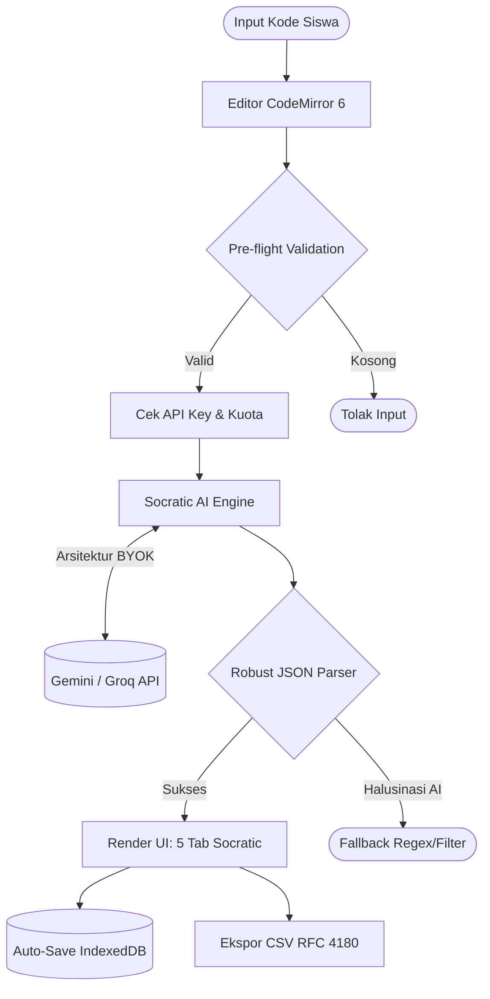

# KoreksiKoding

Platform analisis kode berbasis AI. Kode dianalisis secara instan untuk mendeteksi error, warning, saran perbaikan, dan menghasilkan kode yang sudah diperbaiki.

## Alur Inti

Berikut adalah langkah yang dilakukan pengguna dari awal sampai akhir beserta arsitektur pemrosesannya:

**Arsitektur Alur Pengguna (User Flow):**

1. Buka aplikasi di browser, pilih atau tulis kode pada editor CodeMirror 6.
2. Klik tombol analisis atau jalankan perintah untuk mendeteksi error, kerentanan, dan optimasi.
3. Tinjau hasil analisis, perbaikan instan, mode belajar, atau konversi kode yang dihasilkan AI.

## Cara Menjalankan (How to Run)

### Prasyarat

- Node.js versi 18 atau lebih baru
- Browser modern (Chrome, Firefox, Edge, Safari)

### Langkah

1. Clone repositori:
    git clone https://github.com/mynamethiris/steampreneur-koreksikoding.git
2. Masuk ke folder proyek:
    cd steampreneur-koreksikoding
3. Install dependensi:
    npm install
4. Jalankan website (development server):
    npm run dev
5. Buka alamat berikut di browser: `http://localhost:5173`

### Akun atau data contoh

Aplikasi ini berjalan secara client-side dan tidak memerlukan login server. Pengguna dapat langsung memasukkan API Key sendiri (Gemini, Groq, atau OpenAI-compatible) yang disimpan secara aman di `localStorage` browser.

| Peran | Username / Provider | API Key / Keterangan |
|---|---|---|
| Pengguna Umum | Gemini / Groq | Masukkan API key masing-masing di halaman Pengaturan |

### Jika terjadi masalah

Bagian ini adalah panduan pemecahan masalah (Troubleshooting Guide) jika penguji mengalami kendala di lingkungan lokal:

- **Port 5173 sudah dipakai**: Vite otomatis menawarkan port alternatif (misalnya `5174`), atau jalankan dengan `npm run dev -- --port 3000`.
- **Error npm ERR! code ERESOLVE saat install**: Terjadi karena konflik *peer dependencies*. Gunakan perintah `npm install --legacy-peer-deps`.
- **Layar Putih (Blank Screen)**: Hapus cache lokal dengan membuka Developer Tools (F12) > Application > Clear Site Data, lalu muat ulang halaman.
- **API Key Error**: Pastikan kuota API key mencukupi dan format endpoint custom sesuai standar OpenAI.

## Tangkapan Layar Alur Inti

1. Halaman Utama / Editor: 
2. Hasil Analisis Kode: 

## Cara Menjalankan Pengujian

    npm run lint

Hasil yang diharapkan: linting bersih tanpa error (menggunakan oxlint).

## Fitur

- **Analisis Cerdas** - Deteksi error, warning, saran perbaikan otomatis pakai AI
- **CodeMirror 6** - Editor kode dengan syntax highlighting untuk 20+ bahasa
- **Perbaikan Instan** - Kode yang sudah diperbaiki beserta penjelasan detail
- **Keamanan & Duplikasi** - Deteksi vulnerability (CWE) dan code duplication
- **Mode Belajar** - Konsep pemrograman terkait dan tips untuk meningkatkan pemahaman
- **Terminal Error Analyzer** - Analisis pesan error terminal dan dapatkan solusi
- **Code Converter** - Konversi kode antar bahasa pemrograman dengan penjelasan
- **Prompt Builder** - Buat dan perbaiki prompt untuk AI
- **Coding Challenge** - Tantangan coding interaktif dengan verifikasi solusi
- **Typing Test** - Latihan mengetik kode dengan pengukuran WPM dan akurasi
- **Snippet Sharing** - Bagikan kode via link (berlaku 2 jam)
- **Learning Guides** - Panduan belajar interaktif dengan quiz
- **Riwayat Analisis** - Tersimpan lokal di IndexedDB, bisa di-export ke JSON/CSV
- **Multi Provider** - Gemini, Groq, atau custom provider OpenAI-compatible
- **Dark/Light Mode** - Toggle tema gelap dan terang
- **Responsive** - Split-pane di desktop, tabbed view di mobile
- **Privasi Terjaga** - Tidak ada backend, kode tidak pernah disimpan di server
- **Multi Bahasa** - Dukungan Indonesia dan English

## Batasan yang Diketahui

- Analisis sepenuhnya bergantung pada ketersediaan koneksi internet dan kuota API key eksternal yang digunakan.
- Penyimpanan riwayat terbatas pada kapasitas IndexedDB browser lokal.

## Struktur Folder

| File / folder | Isi |
|---|---|
| `docs/` | Dokumen proses kerja (spesifikasi, rencana, log prompt, kasus uji, dan lainnya) |
| `src/` | Kode sumber aplikasi (React + TypeScript) |
| `public/` | Aset statis |

## Sumber dan Lisensi

| Nama | Sumber (link) | Lisensi |
|---|---|---|
| React | [https://react.dev](https://react.dev) | MIT |
| Vite | [https://vite.dev](https://vite.dev) | MIT |
| Tailwind CSS | [https://tailwindcss.com](https://tailwindcss.com) | MIT |
| CodeMirror 6 | [https://codemirror.net](https://codemirror.net) | MIT |
| Lucide Icons | [https://lucide.dev](https://lucide.dev) | ISC |

## Tim

| Nama Lengkap | Akun GitHub | Peran |
|---|---|---|
| Favian Zufar Niardi | [@mynamethiris](https://github.com/mynamethiris) | Frontend Engineer, UI/UX, Navigation Logic |
| Andante Akmal Alvaro | [@andanteakmalalvaro-lab](https://github.com/andanteakmalalvaro-lab) | AI Parser, Security Engineering, Build Setup |
| Bastian Nathaniel Inhadi | [@BazBizBuz](https://github.com/BazBizBuz) | State Management, IndexedDB, Testing |